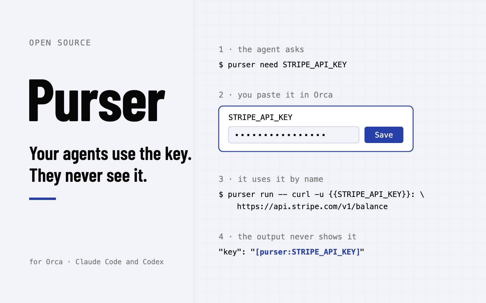

<p align="center"></p>

# Purser

Stop pasting API keys into the chat. Purser is an [Orca](https://github.com/stablyai/orca)
plugin: when an agent needs a key, it asks, Orca shows a masked field next to the conversation,
you paste, and the agent goes on. Claude Code, Codex and any other CLI use the key by name and
never see the value.

```
agent:  purser need STRIPE_API_KEY "to read the test balance"
you:    (the Purser panel opens next to the chat; paste the key)
agent:  purser run -- curl -u {{STRIPE_API_KEY}}: https://api.stripe.com/v1/balance
        → wherever the value would appear, the output shows [purser:STRIPE_API_KEY]
```

## Install

From a terminal:

```
orca plugin install santigamo/orca-purser
```

Orca lists the access Purser asks for before it runs. There is nothing else to set up: every
Claude Code and Codex agent Orca starts afterwards already knows how to use it.

## Use

- **An agent needs a key.** It runs `purser need NAME`. You get a notification, the Purser panel
  opens beside the conversation with the field ready, you paste and press Save. The agent picks
  it up on its own. Decline if you would rather not give it.
- **You add one yourself.** The **+** at the top of the panel.
- **Per project.** A key belongs to one project (a Git repository, all its worktrees included)
  or to all of them. Inside a project its own key wins over a global one with the same name, so
  `STRIPE_API_KEY` can hold a different key for each client, and an agent working on one
  client's repository never gets another client's key. What an agent asks for is stored in its
  project unless you pick "All projects".
- **Manage.** Each key can be shown for 10 seconds, edited (new value, or moved to another
  project) or deleted.

## How it works

- **Storage.** Values live in Orca's encrypted plugin secrets, protected by your OS key store
  (macOS Keychain, libsecret, DPAPI). Names and timestamps live in plugin storage. The worker
  never hands a value to anyone but the command it runs; "Show" reads the value inside the panel
  itself.
- **The `purser` command** talks to the plugin over a Unix socket in `~/.purser` (folder `0700`,
  socket `0600`). `run` fills `{{NAME}}` in arguments, puts the project's keys in the child's
  environment, and replaces values (plain, base64, hex, URL-encoded) in its output.
- **Nothing to install.** When Orca starts an agent, Purser gives it `$PURSER_CLI` and a short
  set of instructions: Claude Code through `--append-system-prompt`, Codex through
  `-c developer_instructions=...` (left out when you pass your own). A Claude Code Bash call that
  reads `$NAME` its shell does not have is stopped with how to use `purser run` instead.
- **Agents outside Orca (optional).** The palette command "Purser: Set up agents outside Orca"
  installs a `purser` command into `~/.local/bin` and a skill into `~/.claude/skills` and
  `~/.agents/skills`; "Purser: Remove setup for agents outside Orca" undoes it.

## What it does not protect against

Purser keeps keys out of the chat and the transcript, and on screen only while you ask to see
one. It is not a sandbox: an agent running as your user can still run `purser run -- printenv`
and transform the output in ways the filter does not catch. Treat it as protection against
accidents, not against a hostile agent.

## Requirements

Orca 1.4.248 or later on macOS or Linux, with an OS key store (the macOS Keychain, or libsecret
such as GNOME Keyring). Node.js on the agent's PATH, or none: the command falls back to the Node
inside Orca. Tested on macOS. Windows and agents on SSH hosts are not covered yet.

## Develop

```
npm install
npm run check          # validate, type-check, test, render the panel
orca plugin dev load .
npm run images         # re-render images/*.png from the SVGs (needs Chrome or Chromium)
```

Tests run against a temporary home (`PURSER_HOME_DIR`) and a stand-in `orca` command, never the
real `~/.purser` or your Orca.

## License

MIT. The cover uses Barlow Condensed (SIL Open Font License, `images/fonts/OFL.txt`).
